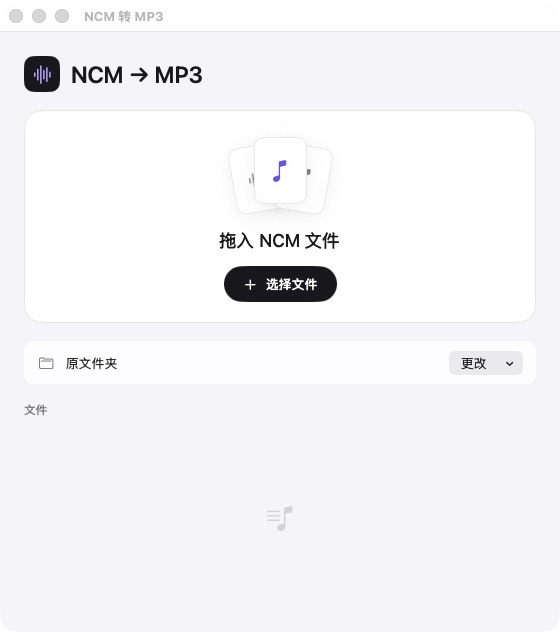
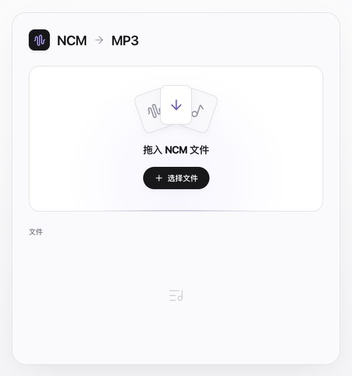

# NCM 转 MP3

拖入 `.ncm` 音频文件，转换为同名 MP3。提供原生 macOS 应用和本地静态网页版。

两种版本都在本机处理音频，无需账号，不上传文件，不依赖在线网站。首次安装构建依赖需要联网，构建完成后可以离线使用。本仓库只存放源码，不启用 GitHub Pages 或其他网站部署。

| 版本 | 使用方式 | 保存位置 |
| --- | --- | --- |
| macOS 原生版 | 拖入窗口、选择文件，或拖到应用图标 | 默认保存到原 NCM 旁边，可更改目录 |
| 本地静态网页版 | 启动后在浏览器拖入或选择文件 | 浏览器下载文件夹，支持逐首下载和 ZIP 打包 |

## 功能

- 沿用原文件名，例如 `歌手 - 歌名.ncm` → `歌手 - 歌名.mp3`。
- 原音轨为 MP3 时保留音频帧；FLAC 转为 44.1 kHz / 320 kbps MP3。
- 保留可解析的歌曲标签和内置封面，不联网补封面。
- 支持批量转换、停止、失败重试；原始 NCM 保留。
- 桌面版遇到已有同名 MP3 时跳过，不覆盖。
- 固定大小的简洁界面，叠层文件卡片及按压反馈；遵循减少动态效果设置。

| macOS 原生版 | 本地静态网页版 |
| --- | --- |
|  |  |

## 获取源码

```sh
git clone https://github.com/02whai/ncm-to-mp3-local.git
cd ncm-to-mp3-local
```

## 本地静态网页版

构建需要 Node.js 20.19+ 或 22.12+；启动器需要 Python 3。浏览器运行音频转换，不需要安装系统 FFmpeg。

```sh
cd web
npm ci
npm run build:local
cd ..
```

Mac 在 Finder 中双击根目录的 `启动网页版.command`。也可以进入生成的 `dist/NCM 网页版/`，双击其中的 `启动.command`。

其他系统运行：

```sh
python3 web/start.py
```

浏览器自动打开本机地址 `http://127.0.0.1:8765/`；端口占用时会自动选择空闲端口。关闭启动窗口或按 Ctrl+C 即可停止。启动器只提供静态文件，所有转换都在浏览器内完成。

生成的 `dist/NCM 网页版/` 包含全部页面和转换组件，可以整包复制。运行该离线包需要 Python 3，无需再安装 Node.js、npm 依赖或联网。

开发模式：

```sh
cd web
npm run dev
```

详细说明见 [web/README.md](web/README.md)。

## macOS 原生版

当前支持 **Apple Silicon Mac，macOS 13+**。需要 Xcode Command Line Tools、Python 3、TagLib 和 FFmpeg：

```sh
xcode-select --install
brew install python taglib ffmpeg
python3 scripts/build.py
open "dist/NCM 转 MP3.app"
```

已安装 Xcode Command Line Tools 时跳过第一行。构建脚本会下载并校验官方 ncmdump 1.5.1，编译 SwiftUI 界面，将 TagLib 和原文许可随应用打包，并完成本地签名。

构建产物是 `dist/NCM 转 MP3.app`。应用运行时使用本机的 FFmpeg / FFprobe，会检查 `/opt/homebrew/bin`、`/usr/local/bin`、`/usr/bin` 和 `PATH`。首次构建完成后，日常转换无需网络。当前采用本地签名，未提供 Apple 开发者分发签名或公证。

## 验证

桌面版先构建，再运行：

```sh
python3 tests/integration.py
```

网页版：

```sh
cd web
npm test
npm run build
```

网页测试需要 `ffmpeg` 和 `ffprobe` 在 `PATH` 中，也可通过 `FFMPEG` / `FFPROBE` 指定路径；这只是测试依赖，浏览器实际转换不调用系统 FFmpeg。

测试音频由正弦波生成，无真实歌曲。桌面版的 12 项集成验证覆盖原 MP3 音频帧保留、96 kHz FLAC 转 MP3、中文/空格/emoji/大写扩展名、标签与封面、原文件不变、重名保护、错误输入和队列继续处理。网页的 5 项测试验证现成解密库、标签和封面、损坏输入及文件名。

网页版已在 Chrome 中完成批量转换与 ZIP 下载，并用 FFprobe / FFmpeg 验证实际输出编码、标签、封面和完整解码。本地离线包的全部 WASM 分块也经过 SHA-256 完整性校验。实际 NCM 兼容性以具体输入文件为准。

## 项目结构

```text
Sources/                 原生界面、转换核心和命令行入口
scripts/                 macOS 构建脚本和图标生成
tests/                   原生转换集成验证
web/src/                 静态网页和浏览器转换器
web/scripts/             静态资源准备及离线打包
web/start.py             本机静态文件启动器
web/tests/               合成 NCM 测试文件和验证
vendor/                  原生组件许可和来源记录
docs/                    选型记录和界面截图
启动网页版.command        Mac 双击启动入口
```

依赖、构建输出、生成的音频和下载的原生二进制不进入 Git 仓库。`web/tests/fixtures/` 中的 NCM 是专门生成的测试数据。

## 开源组件与许可

桌面版使用 [taurusxin/ncmdump](https://github.com/taurusxin/ncmdump) 和本机 [FFmpeg](https://ffmpeg.org/)；网页版使用 [ncmdump-js](https://github.com/ant-cave/ncmdump-js) 和 [ffmpeg.wasm](https://github.com/ffmpegwasm/ffmpeg.wasm)。

本项目自有代码采用 [MIT](LICENSE)。第三方组件保留各自许可，尤其 `@ffmpeg/core` 采用 GPL-2.0-or-later。版本、来源和许可说明见 [THIRD_PARTY.md](THIRD_PARTY.md)。
